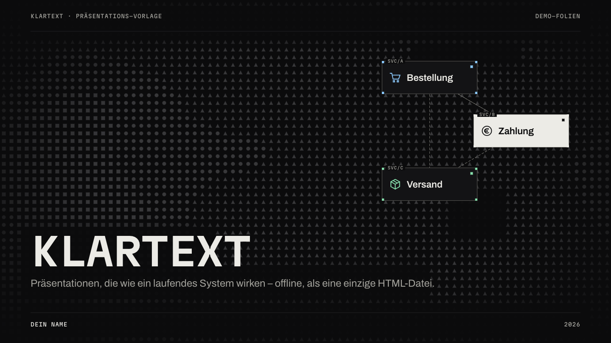

# Klartext – deutsche Kurzfassung

**Klartext ist ein Design-System in Schwarz und Weiß, wie Code und Schreibmaschine – mit einem lebenden Formen-Feld als Hintergrund und einer Engine für HTML-Präsentationen, die offline laufen.**



**[▶ Demo-Präsentation online](https://galaxycoders.github.io/klartext/demo/presentation.html)** · **[Musterseite des Design-Systems](https://galaxycoders.github.io/klartext/design-system/beispiel/)** · [Releases](https://github.com/GALAXYCODERS/klartext/releases) · [English README](README.md)

„Klartext“ ist doppelt gemeint: *plaintext* (unverschlüsselt, wie Code) und „Klartext reden“ (ohne Schnörkel). Titel werden **getippt**, Werte **entschlüsselt**, Rahmen **konstruieren** sich, und darunter **atmet** ein Feld aus kleinen Formen.

## Woran man Klartext erkennt

- **Schwarz/Weiß trägt alles.** Zwei Themes: *Nacht* (Standard) und *Papier* (helle Räume, Beamer, Druck).
- **Farbe ist selten und bedeutet immer etwas:** Hellblau = Akzent A, invertiert = Akzent B, Grün = Akzent C, **Rot nur für Fehler**.
- **Zwei Stimmen:** Martian Mono (Versalien) für Titel, Werte, Code = die Maschine. Archivo für alles zum Lesen = der Mensch.
- **Haarlinien mit Eckquadraten** statt runder Karten mit Schatten.
- **Das Feld** reagiert nur auf Ereignisse, nie als Deko auf die Maus.

Die **Verbotsliste** („kein KI-Look“: keine Neon-Verläufe, kein Glas, keine Emoji, kein Bounce …) steht in der [englischen README](README.md#the-no-ai-look-list) und ausführlich im [Regelwerk](docs/regelwerk.md).

## Drei Wege, es zu nutzen

1. **Nur das CSS:** den Ordner [`design-system/`](design-system) ins eigene Projekt kopieren und `klartext.css` einbinden. Optional dazu Bausteine (`bausteine.js`), Bewegungen (`motion.js`, braucht GSAP) und das Feld (`feld.js`).
2. **Die Präsentations-Vorlage:** `klartext-template.zip` vom [neuesten Release](https://github.com/GALAXYCODERS/klartext/releases/latest) laden oder den Ordner [`template/`](template) nehmen, dann:
   ```bash
   npm ci && npx playwright install chromium
   npm run dev     # Texte in content/slides.js, Notizen in content/regie.js
   npm run build   # → dist/presentation.html – eine Datei, läuft per Doppelklick offline
   npm run pdf     # → dist/presentation.pdf
   ```
3. **Der Claude-Skill:** `klartext-design.skill` vom [neuesten Release](https://github.com/GALAXYCODERS/klartext/releases/latest) laden und in claude.ai unter *Einstellungen → Fähigkeiten → Skills* hochladen. In Claude Code den Ordner [`skill/klartext-design/`](skill/klartext-design) nach `~/.claude/skills/` (alle Projekte) oder `.claude/skills/` (ein Projekt) kopieren. Danach genügt z. B. „Bau mir eine Landingpage im Klartext-Stil“.

## Doku

- [Regelwerk](docs/regelwerk.md): Farben, Typo, Raster, Feld, Bausteine, Bewegung
- [Präsentationen](docs/praesentation.md): Bühne, Klick-Schritte, PDF
- [Feld-API](docs/feld.md) (englisch)

## Lizenz

[MIT](LICENSE). Die Schriften (SIL OFL 1.1) und GSAP (kostenlose GSAP-Lizenz) werden nur als Abhängigkeit geladen und nicht mitgeliefert.
