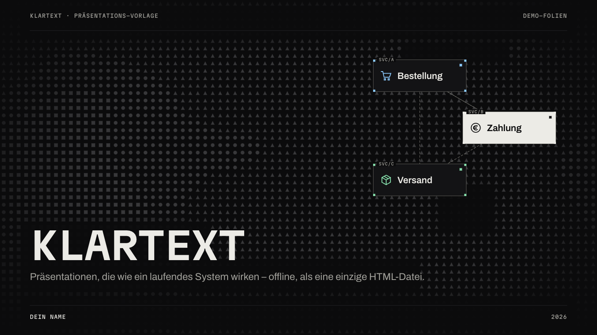
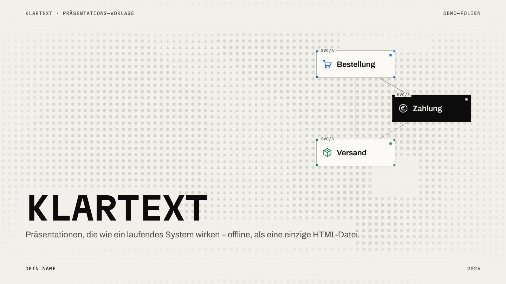
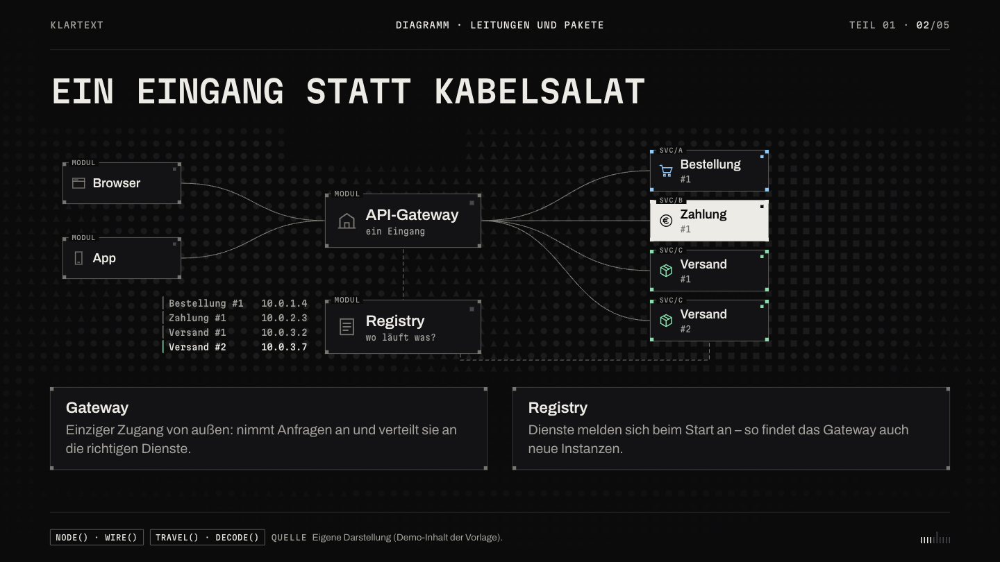
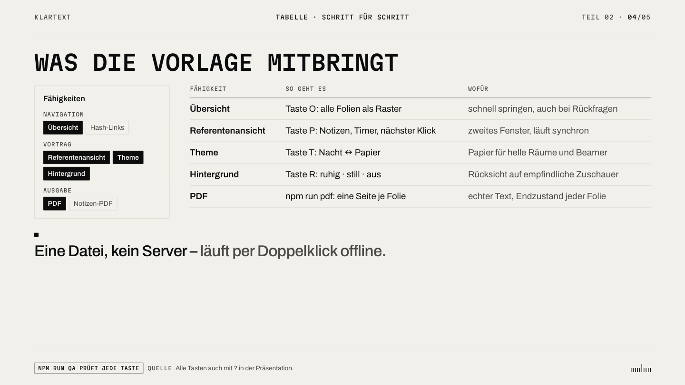

# Klartext

**Klartext – a black-and-white, code-and-typewriter design system with a living shape field, plus an offline HTML presentation engine.**

| Night (dark) | Paper (light) |
|---|---|
|  |  |

**[▶ Live demo deck](https://galaxycoders.github.io/klartext/demo/presentation.html)** · **[Design-system page](https://galaxycoders.github.io/klartext/design-system/beispiel/)** · [Releases](https://github.com/GALAXYCODERS/klartext/releases) · [Deutsche Kurzfassung](README.de.md)

*Klartext* is German for "plain text" — both *unencrypted, like code* and *speaking plainly, without frills*. The result should feel like a running system you read along with: titles are **typed**, values are **decoded**, frames **construct** themselves, and underneath, a field of tiny shapes **breathes**.

## What makes it Klartext

1. **Black and white carry everything.** Two themes: *Nacht* (deep black, warm white — default) and *Papier* (matte paper, ink — for bright rooms, projectors, print).
2. **Colour is rare and always means something.** Light blue = accent A, green = accent C, *inverted* = accent B, **red only for errors and failures**. Never colour alone — always with an icon, a name or a shape.
3. **Two voices.** *Martian Mono* (uppercase) for titles, values, states, code and labels — the machine. *Archivo* for everything you read — the human.
4. **Hairlines with four corner squares** instead of rounded cards with shadows. Radius 0.
5. **A living shape field** (triangle · circle · square on a 24 px grid) — loud on titles, quiet behind content, off behind tables.

### The "no AI look" list

This list *is* the character of the system. If something looks like a template, one of these rules is usually broken.

| Not in Klartext | Instead |
|---|---|
| purple/neon gradients, glow halos, glass/blur | flat surfaces; glow only in the field on a pulse |
| rounded cards with soft shadows | hairline frames with corner squares |
| a kicker line above the title | orientation in a meta line (mono, uppercase); the title stands alone |
| emoji, icon tiles, gradient text | own line icons (1.5 px, square caps) |
| bounce, elastic, zoom, spinning | one calm easing pair, typing, decoding |
| particles as decoration, mouse effects | the field reacts to events only (message arrives, failure, page change) |
| mono as a costume for body text | mono only for titles, values, states, code, labels |

## Quick start — three ways

### 1. Just the CSS (and optionally the JS building blocks)

Copy [`design-system/`](design-system) into your project:

```html
<html data-theme="nacht">
<link rel="stylesheet" href="design-system/klartext.css">
<h1 class="kt-title">Hello</h1>
<p class="kt-text">Plain text, plainly spoken.</p>
```

Add `bausteine.js` for nodes, cards, badges, packets and wires, `motion.js` (GSAP) for typing/decoding/travel, and `feld.js` for the field. Fonts: see [`design-system/fonts`](design-system/fonts/README.md). Details: [`design-system/README.md`](design-system/README.md).

### 2. The presentation template

```bash
# download klartext-template.zip from the latest release, or:
git clone https://github.com/GALAXYCODERS/klartext.git
cd klartext/template
npm ci && npx playwright install chromium
npm run dev        # edit content/slides.js and content/regie.js
npm run build      # → dist/presentation.html, one file, runs offline by double-click
npm run pdf        # → dist/presentation.pdf
```

Click-by-click timelines forwards and backwards, overview (`O`), presenter view with notes and timer (`P`), theme (`T`), field mode (`R`), hash links, clicker keys, PDF and speaker-notes export, and an automated QA run. See [`template/README.md`](template/README.md).

### 3. The Claude skill

The skill teaches Claude the whole system, so you can ask for anything "in Klartext style".

- **claude.ai:** download `klartext-design.skill` from the [latest release](https://github.com/GALAXYCODERS/klartext/releases/latest) → *Settings → Capabilities → Skills → Upload skill*.
- **Claude Code:** copy [`skill/klartext-design/`](skill/klartext-design) to `~/.claude/skills/` (all projects) or `.claude/skills/` (one project).

Then ask e.g. *"Build me a landing page in Klartext style"*.

## Repository layout

```
design-system/   the library (originals): klartext.css, bausteine.js, motion.js, feld.js, icons.js, demo page
template/        the presentation template (Vite, GSAP, Playwright) with five demo slides
skill/           the Claude skill klartext-design (assets synced from design-system/ and docs/)
docs/            regelwerk.md (rulebook), praesentation.md, feld.md (field API), screenshots/
examples/        finished pages and decks built with Klartext
scripts/         sync.mjs (design-system → skill), package.mjs (release assets)
site/            landing page for GitHub Pages
```

**One source of truth:** `design-system/` and `docs/` are the originals. `npm run sync` copies them into the skill; CI fails if they drift (`npm run sync:check`). The template still carries its own, stage-tuned copy of the building blocks — see [`template/README.md`](template/README.md#relationship-to-design-system).

## Docs

- [`docs/regelwerk.md`](docs/regelwerk.md) — the full rulebook: colours, type scale, grid, field, building blocks, motion *(German)*
- [`docs/praesentation.md`](docs/praesentation.md) — Klartext for HTML presentations *(German)*
- [`docs/feld.md`](docs/feld.md) — API of the living field *(English)*

The rulebook is currently in German; an English translation is planned (see issues). Code comments are mostly German; new comments are written in English.

## Examples

| | |
|---|---|
|  |  |

More examples will live in [`examples/`](examples). Built something with Klartext? Open a pull request.

## Accessibility

- All colour tokens meet **WCAG 2.1 AA** in both themes — checked by `npm run contrast` in CI.
- `prefers-reduced-motion` is respected: no flow, no pulses, steps jump instead of animating.
- Colour is never the only signal; failures are red *and* dashed *and* labelled.
- The field can be calmed or switched off by the audience (`R` in the template).

## Contributing

See [CONTRIBUTING.md](CONTRIBUTING.md) — especially the "no AI look" list and the checks to run before a pull request.

## License

[MIT](LICENSE) for code and documentation. Fonts (Archivo, Martian Mono — SIL OFL 1.1) and GSAP (free GSAP license) are dependencies, not part of this repository, and keep their own licenses.
